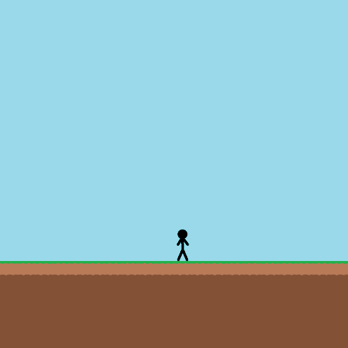
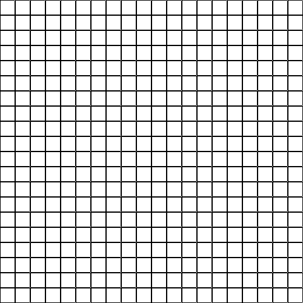
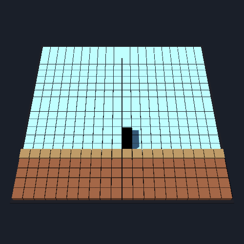
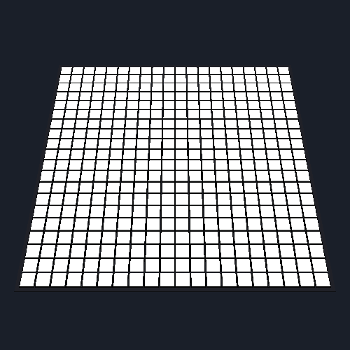

# SDLGrid

A Grid class whereby you can set the screen width, screen height and the # of rows and columns. Uses SDL.

| | `simpleLevel` | `testingGridClass` |
|---|---|---|
| 2D |  |  |
| 3D |  |  |

*The two demo programs in `test/`: a textured level whose ground row is solid, and the default outlined 20x20 grid, in 2D and in the optional 3D view.*

## Requirements

- A C++ compiler (the sources are C++11-compatible)
- SDL2 and SDL2_image development headers

`src/GridClass.h` includes `<SDL.h>` and `<SDL_image.h>` directly, so the SDL2 include directory must be on the include path for any translation unit that uses the library.

## Usage

SDLGrid is not built as a library. The two files in `src/` are vendored directly into a consuming project:

- `src/GridClass.h`
- `src/GridClass.cpp`

A grid is set up once, then drawn each frame. The call order below is the one used by `test/testingGridClass.cpp`:

```cpp
#include "GridClass.h"

const int COLUMNS = 20;
const int ROWS = 20;
const int SCREEN_WIDTH = 500;  // must be a multiple of COLUMNS
const int SCREEN_HEIGHT = 500; // must be a multiple of ROWS

GridClass theGrid;

// after the SDL renderer has been created:
theGrid.init(COLUMNS, ROWS, SCREEN_WIDTH, SCREEN_HEIGHT);
theGrid.setRenderer(gRenderer);
theGrid.createGrid();

// each frame:
theGrid.drawGrid();
```

`setRenderer` must be called before `createGrid`, because `createGrid` copies the renderer into each slot as the slots are constructed.

Individual slots are reached by column and row, and a slot with no texture set is drawn as an outlined rectangle:

```cpp
theGrid.getGridSlot(column, row).setTexture(grassTexture);
theGrid.getGridSlot(column, row).setSolidFlag(true);
```

Drawing a slot with no texture sets the renderer's draw colour to opaque black with `SDL_SetRenderDrawColor` and does not restore it, so once `drawGrid` has drawn any untextured slot, the renderer is left drawing in black. A consumer that depends on the draw colour — for example before `SDL_RenderClear` — must set it again, as both demos do at the start of each frame.

Slot dimensions are computed as `screenWidth / columns` and `screenHeight / rows` using integer division, which is why the screen dimensions should be exact multiples of the column and row counts — otherwise the grid does not reach the right and bottom edges of the window. The screen width and height are stored without being checked, so a screen width smaller than the column count, or a screen height smaller than the row count — including zero or any negative value — gives slots a width or height of zero or less.

A non-positive column or row count is rejected: `init` reports the rejected values on `std::cerr` and returns without storing anything. On a grid that has not yet been initialized, this leaves it at its constructed state of zero columns and zero rows, and a subsequent `createGrid` then builds no slots rather than dividing by zero. On a grid that has already been initialized, the dimensions and slot sizes from the previous successful `init` are kept, and a subsequent `createGrid` rebuilds the grid at those dimensions.

`createGrid` may be called again after a further `init` to rebuild the grid at new dimensions. Each call discards the slots built by the previous call, along with any texture or flag set on them, and invalidates any reference previously returned by `getGridSlot`. The public `solidSlots` and `buttonSlots` vectors are not touched, because they hold copies placed there by the consumer.

### API

`GridClass`:

| Member | Description |
| --- | --- |
| `GridClass()` | Constructs a grid with zero columns and rows, zero screen and slot dimensions, no renderer and no slots |
| `init(int c, int r, int sW, int sH)` | Stores the column count, row count, screen width and screen height, and computes the slot dimensions. A non-positive `c` or `r` is rejected and nothing is stored, so the grid keeps its previous dimensions. `sW` and `sH` are not checked |
| `setRenderer(SDL_Renderer* rendererToSet)` | Sets the renderer handed to each slot by `createGrid`. Slots that already exist keep the renderer they were built with, so a renderer set after `createGrid` reaches them only when `createGrid` is called again or when `GridSlot::setRenderer` is called on each slot |
| `createGrid()` | Discards any existing slots, then constructs and positions `c * r` new ones |
| `drawGrid()` | Renders every slot |
| `getGridSlot(int x, int y)` | Returns a reference to the slot at column `x`, row `y`. No bounds check is performed: `x` must lie in `0` to `getColumns() - 1`, `y` in `0` to `getRows() - 1`, and `createGrid` must have been called since the last successful `init`, otherwise the behaviour is undefined |
| `getColumns()` / `getRows()` | Return the configured column and row counts |
| `solidSlots` / `buttonSlots` | Public vectors a consumer may populate to track slots of interest |

| `getSlotWidth()` / `getSlotHeight()` | Return the slot width and height computed by the last successful `init` |
| `getSlotCount()` | Returns how many slots the last `createGrid` built (`0` before the first), so a caller can tell whether `getGridSlot` is safe to call |

`GridSlot`:

| Member | Description |
| --- | --- |
| `GridSlot()` | Constructs a slot at position `(0, 0)` with zero width and height, no renderer, no texture, an outlined rectangle, and both flags false |
| `init(int x, int y, int w, int h)` | Sets the slot's position, size and collider |
| `setRenderer(SDL_Renderer* rendererToSet)` | Sets the renderer used to draw the slot |
| `setTexture(SDL_Texture* textureToSet)` | Sets the texture drawn in place of the outline; ownership is not taken |
| `render()` | Draws the texture if one is set, otherwise draws a rectangle. Does nothing while the slot has no renderer |
| `drawRectangle(int x, int y, int w, int h)` | Draws an opaque black rectangle at the given position and size, filled or outlined according to the slot's fill state. Does nothing while the slot has no renderer |
| `fillBlack()` / `clear()` | Switch the rectangle between filled and outlined. While a texture is set, `render` draws the texture and never the rectangle, so neither call changes what `render` or `drawGrid` draws until the texture is cleared with `setTexture(NULL)` |
| `setSolidFlag(bool setter)` / `setButtonFlag(bool setter)` | Set the slot's solid and button flags. Neither flag has a getter, and nothing in `GridClass` or `GridSlot` reads them, so setting one changes no behaviour on its own; collision in `simpleLevel.cpp` is checked against the copies placed in `solidSlots` |
| `getTexture()` / `isFilled()` / `getRect()` | Return what `render` draws from: the texture (or `NULL`), the fill state set by `fillBlack` and `clear`, and the position and size set by the last `init` (not `collider`) |
| `collider` | Public `SDL_Rect` matching the slot's position and size, for collision checks. `render` draws from the slot's private position and size, not from `collider`, so changing `collider` moves the slot for collision only; the next `init` overwrites it |

## 3D view (optional)

A grid can also be shown in 3D, drawn by [Strata](https://github.com/Preponderous-Software/strata), with the 2D window as the fallback. It is optional: `GridClass.h` and `GridClass.cpp` know nothing of it, and a program that does not include the two headers below is built and runs exactly as before.

- `src/GridView3D.h` says what the grid looks like in 3D, as plain data with no Strata and no GPU. Every slot is a tile on a dark bed, laid out as the 2D grid is (row 0 at the back, as it is at the top in 2D), with the slot's proportions kept. A textured slot's tile takes its colour and height from its texture's `gridview3d::Look`: set one per texture with `looks.set(texture, look)`, where `gridview3d::lookFromSurface(surface, height)` averages the colour of the surface the texture is made from; a texture with no Look gets the next colour of a fixed palette, so different textures never look alike. A slot with no texture is drawn as its 2D outline is, a white tile on a black edge, or a raised black block after `fillBlack`. A `gridview3d::Marker` (a sprite, a cursor: anything drawn over the grid in 2D) is a block standing over the screen rectangle it covers.
- `src/GridView3DStrata.h` draws that scene in its own window. libstrata (`libstrata.so.0.9` on Linux, `strata.dll` on Windows) is loaded at run time from `STRATA_LIBRARY`, from beside the executable, or from the library path, so nothing links against it; where it is missing, or cannot start (no GPU that runs it), `gridview3d::open` returns `false` with the reason in `gridview3d::reason()`, and the program opens its 2D window as before. `third_party/strata/` holds the `strata.h` it is built against (Strata 0.9.0, MIT), and `tools/fetch-strata.sh linux <dir>` (or `windows`) downloads that release's library and checks it against the release's `SHA256SUMS`.

A program adds five calls to its existing loop:

```cpp
#include "GridView3DStrata.h"

gridview3d::Looks looks;

// before SDL_Init: the 3D window, unless it can't run here
if (!gridview3d::open(SCREEN_WIDTH, SCREEN_HEIGHT, "My grid")) {
	std::cerr << "Showing the grid in 2D: " << gridview3d::reason() << std::endl;
}
// while the 3D window is open, SDL's video subsystem must stay off (it would take the GL
// context Strata draws with): SDL_Init(SDL_INIT_EVENTS) and a software renderer on a
// surface (SDL_CreateSoftwareRenderer) draw the 2D grid into memory instead
if (gridview3d::ownsWindow()) { /* ... */ } else { /* the 2D window, as before */ }

// textures and their Looks
looks.set(grassTexture, gridview3d::lookFromSurface(grassSurface, 0.75f));

// each frame, after the 2D drawing
theGrid.drawGrid();
SDL_RenderPresent(gRenderer);
gridview3d::show(theGrid, looks, markers);   // markers may be left out

// events: SDL's, then the 3D window's
while (SDL_PollEvent(&e) || gridview3d::pollEvent(&e)) { /* ... */ }

gridview3d::close();
```

Input in the 3D window arrives as the SDL events the 2D window would have produced, so a program handles it as it already does: closing the window is `SDL_QUIT`, a key is the same `SDL_KEYDOWN` or `SDL_KEYUP`, and a click or tap on a tile is an `SDL_MOUSEBUTTONDOWN` (and `UP`) at the middle of that slot in 2D window coordinates, inside its `collider`. The slot is found by casting a ray from the camera through the pointer onto the tiles' tops, so a tall tile is picked where it is seen. A click off the grid lands outside the 2D window. Mouse motion is not passed on.

Both demos use it: each opens in 3D where Strata runs and in 2D otherwise, and `--2d` keeps either one to its 2D window. `simpleLevel` gives the sky, grass and dirt textures their average colours at heights 0.04, 0.75 and 0.6, and shows its sprite as a marker, so the sprite falls (towards the front of the board) and comes to rest on the grass row in 3D as it does in 2D. On Linux the demos link `-ldl` for the run-time loading:

```sh
cd test
g++ -std=c++11 -I../src ../src/GridClass.cpp simpleLevel.cpp $(sdl2-config --cflags --libs) -lSDL2_image -ldl -o simpleLevel
STRATA_LIBRARY="$(../tools/fetch-strata.sh linux /tmp/strata)/lib/libstrata.so.0.9" ./simpleLevel
./simpleLevel --2d
```

`test/view3dShots.cpp` draws both demo levels in 3D headlessly (Strata renders offscreen, so no display is needed), at the demos' 500x500 and at a phone's 390x844, and saves each as a PNG; `docs/capture.sh` uses it for the 3D images above when `STRATA_LIBRARY` is set.

## Demo programs

`test/` contains two standalone SDL programs:

- `testingGridClass.cpp` — draws a 20x20 grid of outlined slots in a 500x500 window
- `simpleLevel.cpp` — draws a textured level and drops a sprite that comes to rest on the ground row, whose slots are copied into `solidSlots` for collision checks

Both show the grid in the optional 3D view where Strata can run, and in their 2D window otherwise or with `--2d` (see [3D view](#3d-view-optional)).

Both load their PNGs by relative path, so both must be run from inside `test/`:

```sh
cd test
g++ -std=c++11 -I../src ../src/GridClass.cpp testingGridClass.cpp $(sdl2-config --cflags --libs) -lSDL2_image -ldl -o testingGridClass
./testingGridClass
g++ -std=c++11 -I../src ../src/GridClass.cpp simpleLevel.cpp $(sdl2-config --cflags --libs) -lSDL2_image -ldl -o simpleLevel
./simpleLevel
```

If SDL or SDL_image fails to initialize, the window or renderer cannot be created, or a PNG cannot be loaded (for example because the demo was started from outside `test/`), the demo prints the failing call and the `SDL_GetError()` / `IMG_GetError()` message on `stderr` and exits with status 1.

The screenshots at the top of this README were taken from these two programs
under a virtual X display. `docs/capture.sh`, run from the repository root,
compiles both with the commands above, runs them with `--2d` and regenerates `docs/images/`; it needs
`Xvfb`, `xdotool` and ImageMagick in addition to SDL2 and SDL2_image, and draws the 3D images too when `STRATA_LIBRARY` is set.

## Headless check

`test/checkGridClass.cpp` exercises the parts of `GridClass` and `GridSlot` that need no window: the column and row counts stored by `init`, the rejection of non-positive counts by `init` on both a fresh and an already-initialized grid, the position and size of the slots laid out by `createGrid` on both a square grid and a grid with more rows than columns, the replacement of those slots by a second `createGrid`, the truncated slot size and the uncovered right and bottom edges when the screen dimensions are not multiples of the column and row counts, the zero-width and negative-height slots laid out when the screen is narrower than the column count and its height is negative, and the signatures of `setSolidFlag`, `setButtonFlag` and the public tracking vectors. Drawing is checked by reading pixels back from a software renderer over an in-memory surface: an outlined slot, `fillBlack` and `clear`, a texture hiding the fill state until it is removed, the black draw colour left behind by `drawGrid`, a renderer set after `createGrid`, the fill state and texture dropped by a second `createGrid`, `drawRectangle` drawing at its arguments rather than at the slot's position, `render` ignoring a moved `collider`, the pixels left undrawn by a grid that does not reach the right and bottom edges, a 1x1 texture stretched to cover its whole slot, and a slot copied into `solidSlots` being drawn and filled independently of the slot in the grid, which `drawGrid` alone draws. The 3D view's scene (`src/GridView3D.h`, no GPU needed) is checked too: the slot getters it reads, where each slot's tile stands (slots twice as wide as tall included), the tiles of outlined, filled and textured slots and what `clear` and `setTexture(NULL)` turn them back into, a texture's Look (averaged from a surface, transparent pixels skipped, or the palette's next colour), a marker's block over simpleLevel's resting sprite, a click on the middle or near a corner of every tile top picking that slot at a 500x500, an upright phone's and a sideways phone's view shape (tiles of mixed heights included), clicks off the grid picking nothing, and a 3D click landing inside the slot's `collider` in 2D. It never calls `SDL_Init`, so it runs on a machine with no display. Each failed expectation is reported on `stderr`, and the process exits non-zero if any failed:

```sh
cd test
g++ -std=c++11 -I../src ../src/GridClass.cpp checkGridClass.cpp $(sdl2-config --cflags --libs) -o checkGridClass
./checkGridClass
```

## License

SDLGrid is made available under the terms of the [MIT License](LICENSE). See [COPYRIGHT.md](COPYRIGHT.md).
